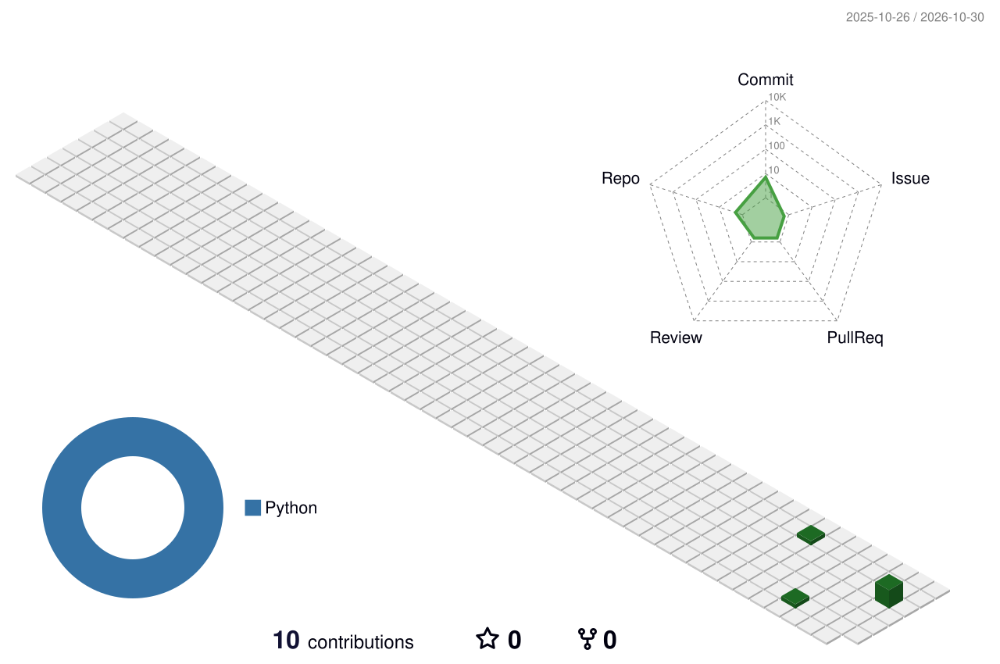

## About

I build websites and web apps, and help businesses automate repetitive work with practical AI integrations. I also work on SEO and digital marketing.

## Focus areas

| Area | What I work on |
|---|---|
| Web development | Modern, responsive websites and web apps |
| Business automation | Workflows that remove manual, repetitive tasks |
| AI integrations | Practical AI features inside real tools |
| SEO & marketing | Search visibility and digital marketing |

## Projects

| Project | Status |
|---|---|
| [SHOPORA](https://github.com/jee788889-source/SHOPORA) | In progress |

## Contributions

<!-- Generated daily by .github/workflows/profile-3d.yml from real GitHub contribution data. Appears after the first workflow run. -->
<picture>
  <source media="(prefers-color-scheme: dark)" srcset="profile-3d-contrib/profile-night-rainbow.svg" />
  
</picture>
